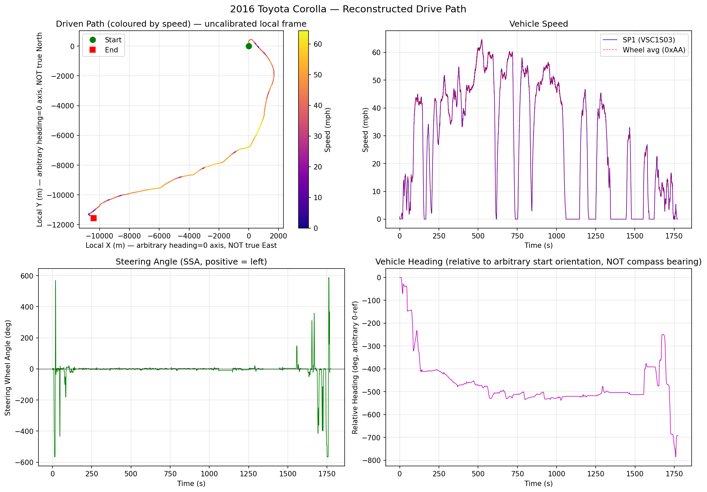
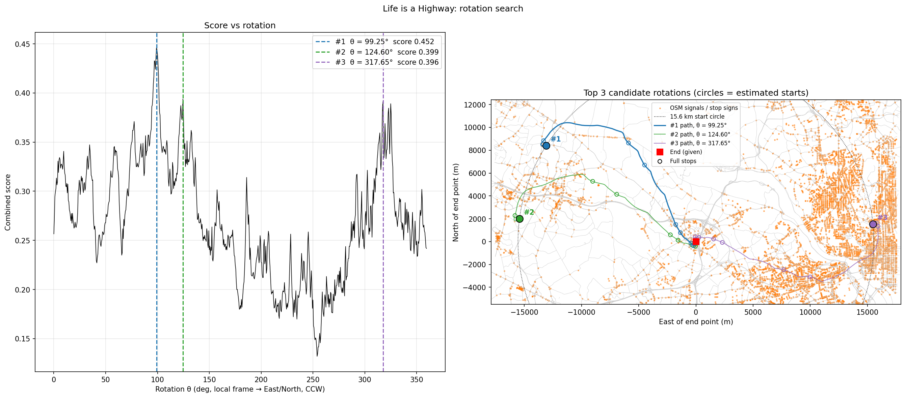
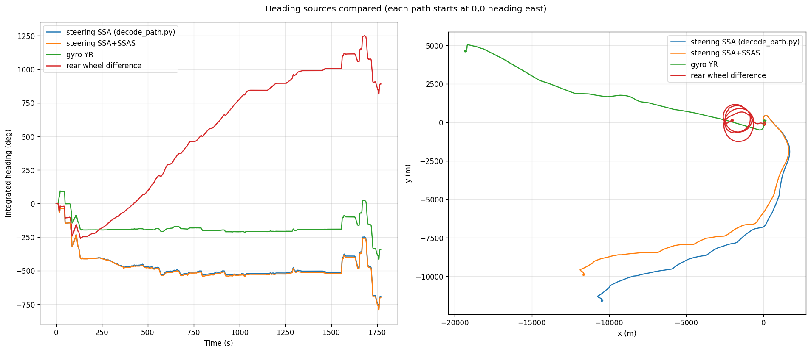
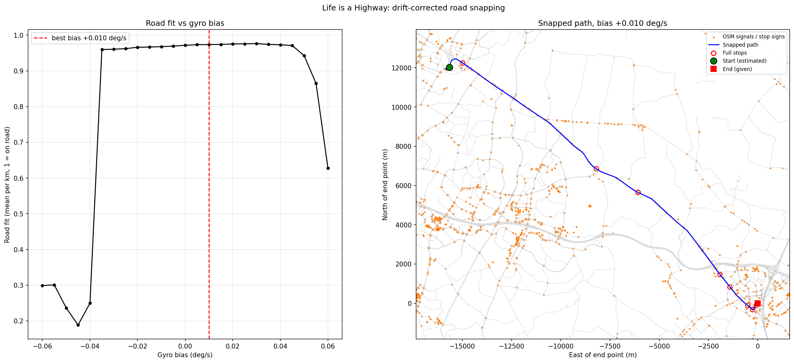

# Life is a Highway — Writeup

## Approach
1. Decode speed and steering from the CAN log.
2. Dead-reckon the path. This gives its shape and distance, but not its orientation.
3. Pin the path's end on the given coordinate.
4. Try one rigid rotation against real roads. This gets the direction roughly right, but the path drifts off the map.
5. Switch to the yaw-rate gyro and snap the path to roads, allowing a little accumulated heading drift.

## 1. Decode the CAN log

The IDs match Toyota's layout (a 2016 Corolla). Decode with commaai [opendbc](https://github.com/commaai/opendbc) `toyota_2017_ref_pt.dbc`:

| ID | Signal | Use |
|---|---|---|
| `0x0AA` | `VXFL/FR/RL/RR` | Wheel speeds |
| `0x025` | `SSA` | Steering-wheel angle |
| `0x0B4` | `SP1` | Vehicle speed (cross-check) |

> `cantools` fails on the reference DBC as-is. Strip the messages with frame IDs above `0x1FFFFFFF` first.

## 2. Dead reckoning — `decode_path.py`

A kinematic bicycle model (wheelbase 2.70 m, steering ratio 15.5) integrated every 20 ms:

```
θ += (v / L) · tan(SSA / 15.5) · dt
x += v · cos(θ) · dt
y += v · sin(θ) · dt
```

Output: `path_data.csv` and `path_reconstruction.png`.



| | |
|---|---|
| Duration | 1773 s |
| Distance driven | 21.98 km |
| Net displacement | **15.56 km** |
| Top speed | 64 mph |

## 3. The problem: no compass

The CAN data has no GPS or compass, so the reconstructed path's orientation is arbitrary.

- **Translation:** fixed by the given end point.
- **Scale:** fixed by the wheel speeds.
- **Rotation θ:** unknown. The start could be anywhere on a 15.6 km circle around Tysons.

## 4. Solving the rotation — `locate_start.py`

The script reads `path_data.csv` and sweeps θ from 0° to 360°. At each θ it rotates the path, pins the end on the given coordinate and scores the fit against OpenStreetMap data:

- **Road score:** share of the path within 20 m (full credit) or 50 m (half credit) of a mapped road.
- **Stop score:** how close each full stop (under 1 mph) lands to a traffic signal or stop sign. Credit falls from 1 at 0 m to 0 at 100 m.
- **Drift weighting:** points near the end count more, because heading error grows with distance from the anchor.

OSM data is pulled from Overpass for the whole ~17.5 km circle, so no region is assumed.



```
rank  θ (deg)  combined   road   stop  start lat, lon
   1    99.25     0.452  0.419  0.486  38.99224, -77.37212   Dranesville/Reston, VA
   2   124.60     0.399  0.413  0.385  38.93463, -77.39914   Oak Hill, VA
   3   317.65     0.396  0.438  0.353  38.93050, -77.04231   Washington, DC
```

At θ = 99.25°, 7 of the 11 mid-trip stops are within 100 m of a real signal. Every one of those hits is on the final approach into Tysons.
This only gives a rough direction. The path does not follow the map, so error is building up somewhere.

## 5. Where the drift comes from — `compare_heading.py`

The bus has more than one heading source:

| Source | Signal |
|---|---|
| Steering + bicycle model | `0x025` `SSA` (+ `SSAS`, a 0.1° fine angle) |
| Yaw-rate gyro | `0x024` `YGS1S03.YR` (0.244 deg/s per bit) |
| Rear wheel difference | `0x0AA` `(VXRR - VXRL) / track` |

```
Turns: gyro = 0.723 × steering, r = 0.987   → bicycle model over-turns by 38%
Highway: steering -0.162 deg/s, gyro -0.050 → steering drifts -59° on the highway
First 30 s: steering -37°, gyro +89°          → car reverses out of a spot
```

Steering-based heading is the problem:
- **Understeer:** the bicycle model ignores it, so every turn is too big.
- **Bias:** a 0.1° steering offset is about 80° of drift over 20 minutes.
- **Reversing:** wheel speeds are unsigned, so turns while backing up integrate the wrong way.

The gyro measures rotation directly. Its only unknown is a small constant bias. The mean while stopped (-0.062 deg/s) is not reliable, because the 0.244 deg/s quantisation has too little noise to average out.

Rear wheel difference is useless here (+891° total, small tyre differences dominate).



## 6. Snapping to roads — `snap_path.py`

- Integrate heading from the gyro and distance from the wheel speeds.
- Walk **backward from the known end** in 1 km segments.
- A beam search gives each segment a heading correction so the path lies on OSM roads.
- The correction may change by at most ±4° between segments, so the path still has to match the driving data. It can't jump to any nearby road.
- The first segment tries all 360°, and OSM covers the full 23 km radius, so no region is assumed.
- Sweep the gyro bias from -0.06 to +0.06 deg/s. Among equally good fits, pick the one needing the least correction.



```
bias +0.010 deg/s   road fit 0.974   heading correction span 11°
11/11 stops within 100 m of a signal or stop sign
start 39.02468, -77.40192   Cascades, Loudoun County, VA
start spread 69 m across 18 biases from -0.035 to +0.050
```

Why this is trustworthy:
- **Independent check:** stops were not used in the fit, yet all 11 land on signals. The stop at t = 737 s, a 1.3 km miss under the rigid fit, is now 30 m from a signal.
- **Stable:** every bias from -0.035 to +0.050 gives the same start within 69 m.
- **Readable route:** VA-7 (Leesburg Pike), from Cascades/Sterling southeast to Tysons.
## Reproduce

```
pip install -r requirements.txt
./solve.sh
```

`solve.sh` unpacks `../dist/*.log.gz` and runs every script in order. Downloads (DBC, OSM, decoded signals) are cached in `../scratch/`. The first run takes about 20 minutes, mostly Overpass rate limits.

| Script | Output |
|---|---|
| `decode_path.py` | Unpacks the log. Steering-based path → `path_data.csv`, `path_reconstruction.png` |
| `locate_start.py` | Rigid rotation search → `locate_start.png` |
| `compare_heading.py` | Steering vs gyro vs wheel heading → `heading_compare.png` |
| `snap_path.py` | Gyro + drift-corrected road snapping → `snap_path.png`, final answer |
