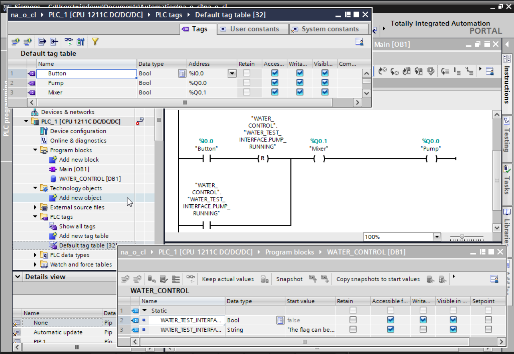
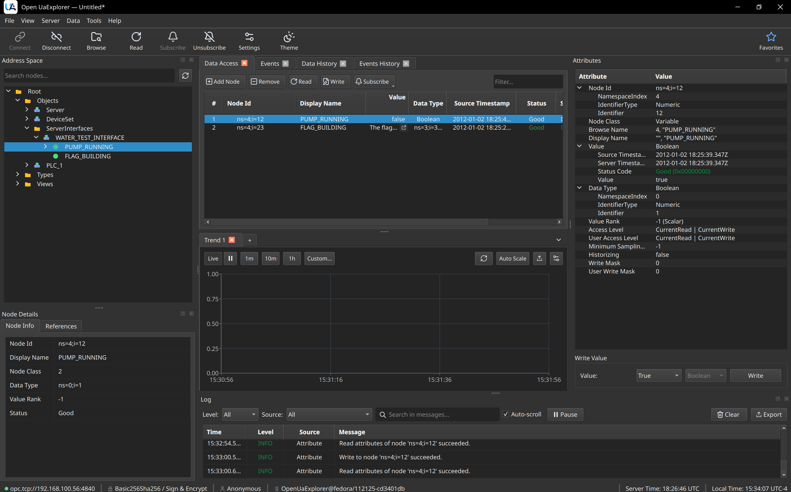
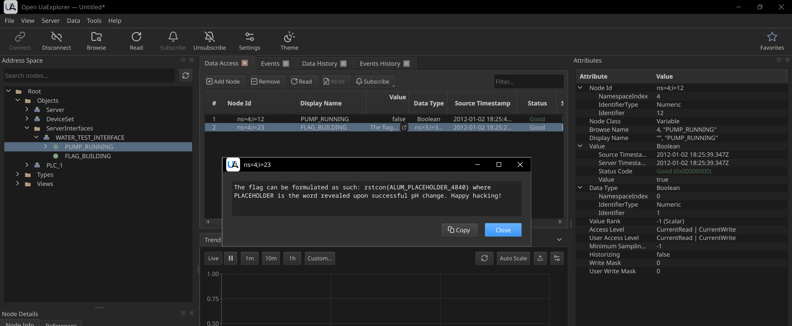
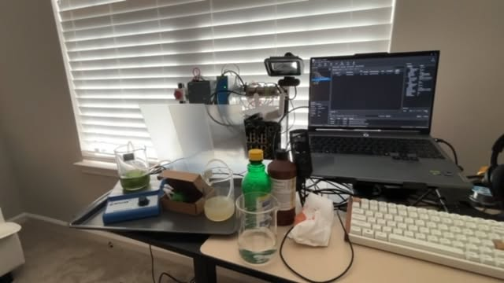
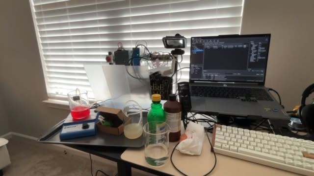

## IP Address

192.168.100.56
## Ports Open

102 (s7comm)
4840 (opcua)
## Known Limitations

10 concurrent opcua connections
potato probably has more processing power
## Program / Ladder Logic

## ROE

Rules of Engagement for Physical Hardware.  
Violation of these will result in me being sad and you owing me alcohol  
  
 - AI is cool, use it. You're responsible for its actions, please QA it. Don't run auto-approve or YOLO mode targeting my hardware, stuff can break and your model doesn't have the intuition / fear of me going "awhhh :(" that you do. Review what you put out there, and keep the packet count down. Think of this as a stealth engagement.  
  
 - No Nmap. Manually test ports you have researched to know exist. These devices were made before anyone thought that an incomplete TCP packet or malformed UDP packet might need to be handled gracefully and may crash the hardware.  
  
 - No spamming / directory busting (do your research before throwing packets)
 - No screen peeking (one solver approach the PLC at a time)
 - You don't need to touch anything. If you really wanna, be careful (24VDC after power supply, 120VAC before power supply.
 - After a solve, find phlebas (big dude) to reset the challenge (pour the fancy chemicals in ooo shiny)
## Solve

manual enum of s7comm may lead to exploitation, but will likely prove difficult. for this, the opcua protocol hint is given in the tags of the challenge.

In this example, I use openuaexplorer since it is FOSS, but python asyncua or UaExpert will work fine since they both speak opcua.

Change connect timeout to 600000 ms and request timeout to 600000 (otherwise will end your requests quickly, the hardware is slow)

The kit will then turn on, activating the peristaltic pump and magnetic bar stirrer. This will cause source beaker (lemon juice / water solution) to pump into destination beaker (ph universal indicator / water solution), changing color from dark green to light red and revealing the final component needed for the flag

The last word for the flag will be written on the side or bottom of beaker in dark green, being hard to see until the liquid turns red.

`rstcon{ALUM_FLOCCULANT_4840}`

